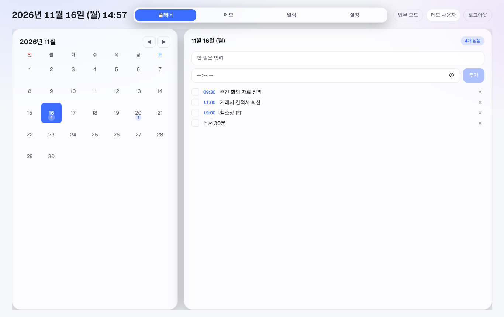
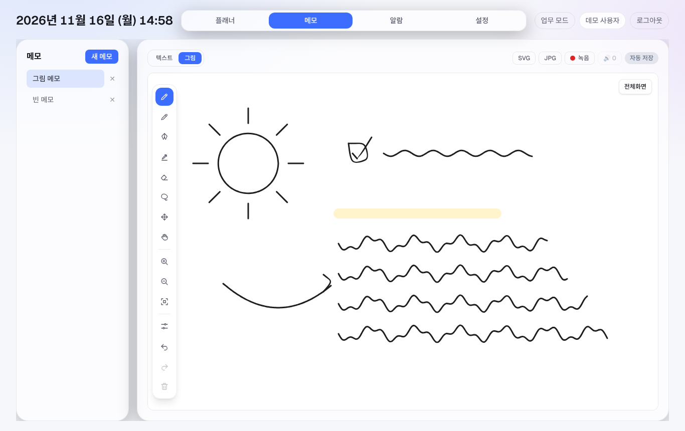

# Day Sphere

> A personal daily dashboard (PWA) for plans, to-dos, handwritten memos and alarms.
> Data is stored as plain Markdown in an Obsidian-compatible vault, so your notes stay readable outside the app.
> Built with Next.js, React and a custom pressure-sensitive ink engine.

개인 일정, 할 일, 메모, 알람을 **한 화면에서 관리하는 대시보드**입니다.
휴대폰·태블릿·PC 어디서나 앱처럼 설치해 쓸 수 있고(PWA), 모든 기록은 옵시디언(Obsidian)에서도 열리는 **마크다운 파일**로 저장됩니다.

| 플래너 | 필기 메모 |
|---|---|
|  |  |

<sub>화면 속 자료는 모두 예시 데이터입니다.</sub>

---

## 주요 기능

- **플래너** — 월간 달력과 날짜별 할 일 체크리스트
- **필기 메모** — 펜 압력을 반영하는 손글씨 캔버스
  - 펜·만년필·연필·형광펜·지우개, 색·굵기, 실행 취소/다시 실행
  - 줄·모눈 종이 배경, 두 손가락 확대·이동, 펜만 인식 모드(손바닥 터치 무시), 올가미로 골라 옮기기
- **음성 녹음 메모** — 브라우저 기본 녹음 기능으로 메모에 음성을 붙입니다(외부 전송 없음).
- **알람** — 아날로그 시계와 시간 선택기로 알람 설정
- **내보내기** — 할 일과 메모는 PDF로, 손글씨 그림은 SVG·JPG 이미지로 저장
- **옵시디언 연동** — 데이터 원본이 마크다운 볼트라서, 앱 밖에서도 옵시디언으로 그대로 열람·편집할 수 있습니다.
- **여러 사용자** — 로그인과 사용자 관리, 기기별 화면 설정(휴대폰·태블릿·PC)

## 기술 스택

| 구분 | 사용 기술 |
|---|---|
| 프레임워크 | Next.js 16 (App Router) · React 19 · TypeScript |
| 화면 | Tailwind CSS 4 · Framer Motion |
| 필기 엔진 | perfect-freehand 기반 자체 잉크 엔진 |
| 저장소 | Markdown 파일 (gray-matter) — Obsidian 호환 볼트 |
| 배포 | Docker · PWA (홈 화면 설치) |

## 빠른 시작

```bash
npm install
npm run dev
```

브라우저에서 `http://localhost:3000` 으로 접속합니다.
서버에 올릴 때는 `docker-compose.unraid.yml`을 참고하세요.

### 저장 위치 바꾸기 (환경 변수)

| 변수 | 의미 | 기본값 |
|---|---|---|
| `DAY_SPHERE_DATA_DIR` | 앱 데이터(계정·설정) 폴더 | `./.day-sphere` |
| `DAY_SPHERE_OBSIDIAN_DIR` | 마크다운 볼트 폴더 | `<데이터 폴더>/obsidian-vault` |

---

만든 사람: [hunmonkey](https://github.com/hunmonkey)
